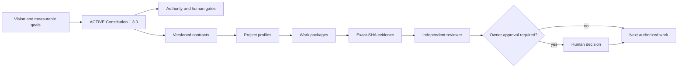
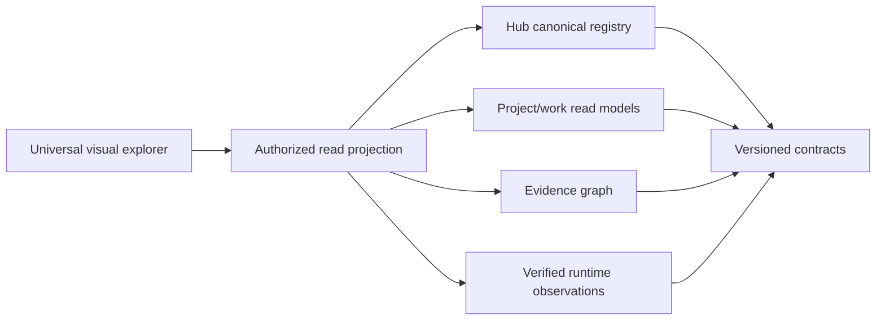
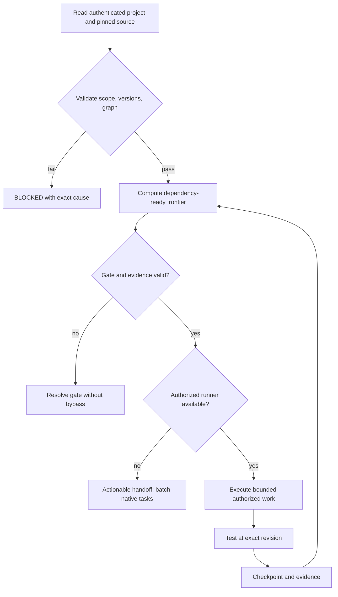
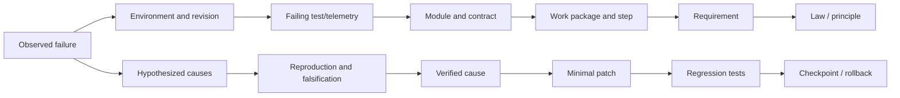
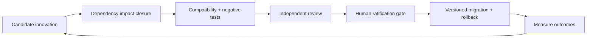

# MASTER SYSTEM PRINCIPLE & ALGORITHM ATLAS — Candidate 0.1
Status: DRAFT; exact baseline main@0d0d0bece3afa82aaf5792a64c0d4bab56dc9825 (checked 2026-11-22). Linked to PR #173. Not ratified, not deployed.

## A. Purpose, fidelity and source-of-truth
Create a complete, inspectable, evolving atlas of Blueprint OS: constitutional principles, project topology, module architecture, algorithm contracts, AI/learning, human action, operational evidence, and future roadmap. Preserve dense vertical neuron-column visual language from user reference: fine curved multicolored edges, dark technological background, clustered glow and depth, without compromising text contrast, reduced-motion, accessibility or performance. **Visual style is a presentation projection; never use visual proximity as evidence of a dependency.**
Existing ACTIVE 1.3.0 normative law, canonical project profiles, repository HEADs, authority service, quality gates and evidence ledgers remain sources of truth. This atlas must never become an alternative authority or invent real-time state.

## B. Global graph ontology (typed, versioned)
Node classes: Vision, Principle, ConstitutionClause, Amendment, Authority, Project, Repository, Module, Interface, Contract, Requirement, Goal, WorkPackage, Step, Algorithm, Formula, Dataset, Model, TrainingRun, Experiment, Test, Gate, Evidence, Defect, Incident, Decision, Release, Runtime, Device, Capability, Checkpoint, FutureCandidate.
Edge classes: REFINES, INHERITS, SUPERSEDES, DEPENDS_ON, IMPLEMENTS, CALLS, READS, WRITES, PRODUCES, CONSUMES, VERIFIED_BY, GOVERNED_BY, AUTHORIZED_BY, BLOCKED_BY, CAUSES_VERIFIED, SUSPECTED_CAUSE, FIXED_BY, REGRESSED_BY, MIGRATES_TO, COMPATIBLE_WITH, DEPLOYED_AS.
Every node: stable ID, type, title, scope/project, owner, source URL, source SHA/version, state, validFrom, observedAt, confidence/provenance, access classification, supersededBy. Every edge: stable ID, typed endpoints, reason, source ref/revision, direction, temporal validity, trust boundary and verification status. No edge without evidence or explicit 'proposed' label.
State axis: observed / verified / proposed / blocked / superseded. Lifecycle axis separate: planned / ready / in-progress / testing / review / completed / archived. NEVER collapse observed to PASS, candidate to production, or missing telemetry to offline.

## C. Five linked diagrams (the atlas backbone)
### C1. Principle / governance

### C2. System / data architecture

### C3. Algorithm / work execution

### C4. Defect / causal trace

### C5. Evolution

## D. Twelve connected work streams (not twelve independent rounds)
| ID | Stream | Depends on | Deliverable | Exit evidence |
|---|---|---|---|---|
| W00 | Baseline and provenance | none | ACTIVE law, pinned SHA, open PR inventory | exact-source manifest |
| W01 | Vision and measurable goals | W00 | objective/metric tree | owner-readable goals |
| W02 | Constitutional graph | W00,W01 | typed law nodes and amendments | inheritance/conflict checks |
| W03 | Domain/repository graph | W00,W02 | governed projects and source ownership | no duplicate authority |
| W04 | Architecture and interfaces | W03 | data/control/trust boundary diagrams | versioned contract check |
| W05 | Work/algorithm graph | W01,W04 | dependency DAG, READY frontier | cycle/permission/gate tests |
| W06 | QA/evidence/defect lineage | W04,W05 | reversible trace paths | exact-revision negative tests |
| W07 | AI/math/training atlas | W01,W04,W06 | concept→algorithm→formula→code→experiment chain | provenance and correctness |
| W08 | Neural visual explorer | W02,W03,W04,W05,W06,W07 | pan/zoom, progressive disclosure, search/filter | real browser/a11y/performance |
| W09 | Universal Next Action | W05,W06,W08 | single primary action + truthful capability | cross-device state/UX tests |
| W10 | Migration/integration | W02..W09 | backward-compatible vertical slice | real consumer QA |
| W11 | Governance and evolution | W06,W10 | review, impact diff, rollback, adoption | independent review/human gates |

Streams are a dependency graph; parallelize independent READY nodes. Each work item carries round/step lineage, input/output refs, owner, tests, evidence, defect links, checkpoint and rollback. No arbitrary round count as a compliance target.

## E. Algorithm invariants and pseudocode
**Ready frontier**: authenticated snapshot → validate exact project and source → reject unknown refs, duplicate IDs, self-edges, hard dependency cycles → classify unfinished nodes → ready = status in {ready,in-progress,testing} AND all hard predecessors completed AND all required gate evidence authenticated → rank in-progress/testing/ready then stable ID → revalidate immediately before mutation → execute only with scoped runner/authority. If none ready, identify minimum blocking cut-set and suggest the highest-value permissible repair. Do not treat a prompt or user-edited text as authority.

**Impact analysis**: on change of law/contract/module, traverse outgoing IMPLEMENTS/DEPENDS_ON/VERIFIED_BY/CONSUMES edges respecting versions and scope. Return impacted projects, tests, reviewers, migrations and release gates. Separate definite effects from hypotheses. Invalidate only evidence whose pinned input changes.

**Root-cause analysis**: start with incident+timestamp+environment+SHA; collect reproduction, test, trace, code ownership and dependency paths; maintain hypothesis set; mark CAUSES_VERIFIED only after reproduction/falsification; link minimal fix and regression test; record reopened incidents.

**Progress**: progress = weighted verified acceptance outcomes / weighted total committed acceptance outcomes, with blocked/unverified visible separately; never count generated docs as completed runtime implementation. Report scope changes independently.

**Universal Next Action**: contextual CTA is a host-supported send/resume/navigation operation, not a decorative prompt. Cross-device canonical project state is possible only with authenticated backend and supported host integration. Unsupported host action must be visibly marked and must not masquerade as one-click execution. Batch native Windows interactions after exhausting server-side work; preserve E:\\BaumanWeb path, exact HEAD, logs, exit codes, and one readback.

## F. Visual behavior and usability
- L0: 10 macro domains and cross-domain links; L1: project/contract/module clusters; L2: algorithms/work/evidence; L3: formulas, source, experiments and tests.
- Default shows weighted, meaningful paths; high edge density can be revealed on demand. Search and focus highlight ancestor/descendant and impact radius. Toggle factual / proposed / runtime / incident overlays.
- Visual palette by domain, shapes/line patterns by edge semantics (not color alone), legend and keyboard/touch equivalence.
- Progressive disclosure prevents cognitive overload; save viewport/filter as URL or authenticated preference where supported. Do not assume ChatGPT-host session sync.
- WebGL/Canvas for scale with DOM accessibility mirror, SVG fallback, reduced-motion and static diagram fallback. Measure panning FPS, layout latency, text contrast and 100/1k/10k nodes on target devices; no invented thresholds as PASS.
- Animations only for actual measured events or explicitly labeled simulation; never animate imaginary AI training as live telemetry.

## G. Acceptance gates
G0 exact source/provenance; G1 ontology/invariants; G2 graph completeness and no orphans; G3 algorithm correctness; G4 permissions and project isolation; G5 defect trace/rollback; G6 visual fidelity and accessibility; G7 cross-device Next Action; G8 reviewer A/B; G9 human constitutional/release approval. Distinguish source-only, local-runtime, browser QA, independent review and production evidence. Current status: design-only, none of G1–G9 is claimed PASS.

## H. Future expansion
Phase F1 foundational system topology; F2 detailed neural explorer; F3 AI algorithm and math drilldown; F4 real training/evaluation provenance; F5 predictive impact/simulation (clearly labeled); F6 self-improving recommendations under independent evaluation and human governance. Future phases are candidates, not production commitments.

## I. Next exact engineering action
1. Map canonical contracts from main and PR #166/#168, then reconcile candidate Next Action #173 with #152/#153/#161.
2. Produce machine-readable node/edge schema with validation and fixture graph.
3. Implement one vertical slice: Goal → Work → Gate → Evidence → Defect → Fix → Checkpoint → visual drilldown, retaining the dense neural baseline.
4. Run real tests and publish evidence only to candidate branch; do not merge/ratify/publish without separate authority.
