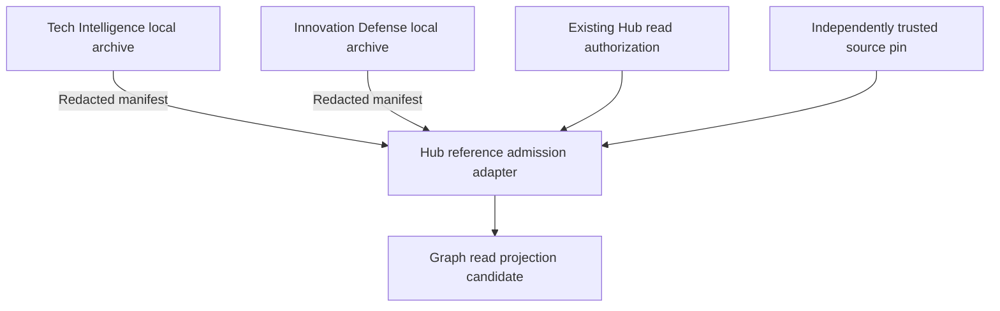

# Dual Intelligence architecture proposal

Baseline: Software-Blueprint-Hub main `cd01fb3c2178393628ce968af209db082227d2c4`, Constitution 1.3.0 ACTIVE. The proposed B3 profiles reflect restricted data custody, independent verification and cross-repository exchange. Canonical classification and enrollment follow Hub governance. The development targets are private and each started with an Owner-authorized README commit.

| Decision | Capability | Pinned Hub or Application Management source |
|---|---|---|
| EXISTS | Canonical profiles, work, gates and evidence | `schemas/vertical-slice.contracts.v1.json` and `packages/blueprint-engine/src/resolver.ts` at `cd01fb3c2178393628ce968af209db082227d2c4` |
| REUSE | Exact-source provenance and deterministic advisory execution | `schemas/reference-import-manifest.v1.json`, `packages/application/src/ai-copilot.ts`, `packages/application/src/prompt-workflow-execution.ts` and `control/execution-service-protocol.v1.json` at the same Hub revision |
| REUSE | Separate Reviewer A/B work order and authority | `packages/application/src/reviewer-ab-contract.mjs` at Hub Draft #163 `f77f299eb114abb2d49c909dde87186e37ba5134`. Draft #167 advances the candidate. Live independent A/B remains a separate decision. |
| EXTEND | Read-only external intelligence references | `packages/application/src/quality-evidence-graph.ts` at Hub main and `packages/application/src/graph-intelligence.ts` at Draft #166 `ca498220ee77e259cca8906622ff9432810288fb`. Keep the adapter independent pending an approved Graph extension. |
| EXTEND | Optional catalog metadata | `control/application-management.contract.json` at Hub main and `app/managed-contract-discovery.server.ts` at Application Management `fef4ebe9bd620fa10a11d972252c69838c1f9079`. GitHub fallback currently reads public repos. |
| NEW | Research rights, falsification and independently usable specification | `packages/application/src/reference-imports.ts` at Hub main handles a frozen reference snapshot. The research workflow belongs to Tech Intelligence. |
| NEW | Authorized asset exposure, mitigation verification and regression | `packages/application/src/security-threat-model.ts` at Hub main handles Hub threats. Exposure-lifecycle records belong to Innovation Defense. |
| REJECT | Shadow governance, canonical data, reviewer, orchestrator, or Graph store | `control/governance-registration-ledger.v1.json` and `control/development-runtime-policy.v1.json` at Hub main keep authority and operational registration separate. |

Each engine runs and retains its private inputs on its own workstation. The shared, versioned format carries an opaque record identity, an exact Git source revision, a content version, a bounded outcome and an integrity digest. The consumer supplies current source pins, trusted time, existing authorization, and current reference state. Digest validity establishes content integrity. Authentication and revocation come from the trusted caller. The adapter has no persistence or gate mutation API. Application Management can consume a metadata-only contract when an authorized private discovery or import path is available.

The first slice uses Node 24 and standard library modules. The engine copies of the portable wire module are exact pinned distributions of the Hub contract, verified by hash. Normal execution needs no Hub checkout, model, database, or online account. Manual source-rights review and deterministic evaluation are the default. Provider execution and legal decisions require separate authorization. The local operator can archive or remove reports and export sanitized metadata with an expiry. A missing or revoked source pin immediately blocks later admission. Recovery reuses the same immutable manifest and the latest trusted source pin. A duplicate must leave reference state unchanged.

Acceptance proceeds through the existing order: profile and ownership, contract, an isolated slice in each engine, then read-only Hub integration, then hardening and human review. Runtime coverage requires two isolated Node executions, exact-source contract parity, and rejection of malformed, foreign, stale, replayed, or sensitive inputs. Graph wiring, authenticated project isolation and catalog enrollment require their real integration paths. A pending Graph or catalog path keeps full federation pending.

The future model adapter boundary is an advisory function over a reviewed, allowlisted summary. It returns an untrusted proposal. Source-rights decisions, measured results and evidence admission stay in their deterministic paths. The current runtime has no provider and uses the deterministic and manual path. Providers need separate approval, redaction and independent QA before activation.
